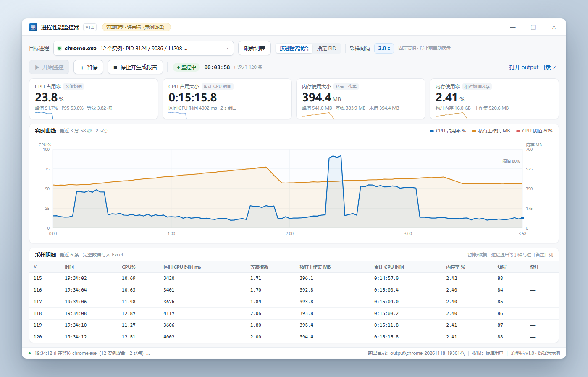
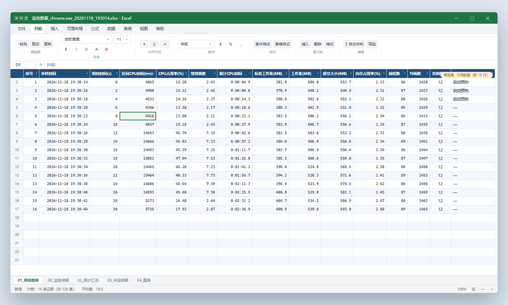
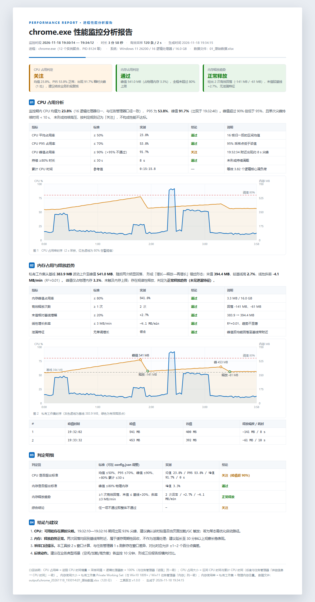

# 进程性能监控与性能分析工具 · 方案设计（v1.0 评审稿）

> **状态**：待评审，未开始开发  
> **目标平台**：Windows 10 1809+ / Windows 11（64 位）  
> **交付形态**：本地 GUI 工具（源码 + 一键启动脚本，可选打包 exe）  
> **本文范围**：方案与原型；不含实现代码。评审通过后按第 8 章计划开发。

---

## 0. 一页看懂

| 维度 | 结论 |
|---|---|
| 做什么 | 选一个进程 → 点「开始」按 2 s 采样 CPU / 内存 → 可暂停/继续 → 点「停止」自动产出 Excel 数据表 + 性能分析报告 |
| 数据口径 | CPU 按「逻辑处理器数归一」，内存取「私有工作集」，与任务管理器同口径（详见第 2 章） |
| 分析结论 | CPU 是否超标 / 内存是否超标 / 内存是否有正常释放趋势，三档判定（通过 / 关注 / 不通过），每条结论都带证据数值与时段 |
| 产物位置 | 全部在工具根目录 `output/` 下，每次监控一个子目录（Excel + 报告 + 元数据） |
| 技术栈 | Python 3.9+ / tkinter / ctypes 直调 Win32 / openpyxl（本机已实测具备） |
| 待确认 | 6 项，见第 9 章（技术栈、CPU「大小」定义、阈值、报告格式、聚合模式、目录结构） |

原型图（本次评审稿）：







---

## 1. 需求理解与范围

### 1.1 需求逐条对照

| # | 原始需求 | 设计响应 | 验收方式 |
|---|---|---|---|
| R1 | 手动控制开始/停止，监控某进程 CPU、内存的「大小」和「占用率」 | 四态控制：开始 → 暂停 → 继续 → 停止；采样本机进程的 CPU 时间、私有工作集、工作集、提交大小、线程/句柄 | A1 状态机可用，操作有明确反馈 |
| R2 | 每 2 s 记录一次；Excel 输出时间、CPU 大小与占用率、内存大小与占用率 | 固定 2 s 节拍（可在 config 调整）；15 列明细表，含时间/CPU 时间/CPU%/私有工作集/内存% | A2 行数=样本数、时间递增、无空值 |
| R3 | 根据记录数据做性能分析并输出性能报告 | 规则引擎（阈值可配）+ HTML 报告（含图表）+ Markdown 摘要 | A4 三项核心结论齐全且附证据 |
| R4 | 重点：CPU/内存是否超标；监控期内内存是否有正常释放趋势 | CPU 五项指标判定；内存占用判定；释放事件识别 + 趋势/泄漏判定（算法见 6.2） | A4 报告含释放事件表与斜率结论 |
| R5 | 数据要和任务管理器一致 | 口径对齐（CPU 归一核数、内存私有工作集、按进程名聚合），并给出容差与抽检方法 | A3 抽检 10 次 ≥9 次达标 |
| R6 | 所有输出文档放工具根目录 `output/` | 统一输出目录；每次监控一个子目录；报告内回链数据文件 | A5 产物路径检查 |
| R7 | 先出方案和原型图，审核后再开发 | 本文 + 3 张原型图 | 你确认第 9 章 |

### 1.2 范围边界

**做**：单机、单进程（支持同名多实例聚合）、手动控制、2 s 采样、Excel 明细、规则化性能分析、HTML/MD 报告、异常兜底。

**不做**（本期）：多进程同时监控、远程/跨机监控、7×24 常驻采集、进程注入或函数级剖析、自动结束/重启被测进程、与 CI 集成。架构上预留扩展点（采样器与界面解耦、多目标可并行），后续可加。

---

## 2. 核心难点：怎么和任务管理器「数据一致」

这是本需求最容易踩坑的地方。任务管理器并不直接暴露「一个进程用了多少 CPU、多少内存」，它是按特定口径算出来的；工具必须复刻同一套口径，否则数值看着「差不多」但永远对不上。

### 2.1 CPU 口径

任务管理器「进程」页的 CPU 百分比，本质是：

```
CPU% = Δ(进程所有线程的 CPU 时间) ÷ Δ(墙钟时间) ÷ 逻辑处理器数 × 100
```

- CPU 时间 = 内核态 + 用户态时间（`GetProcessTimes`），单位 100 ns；
- 除以逻辑处理器数，是因为任务管理器显示的是「占整机 CPU 的百分比」，不是「占单核的百分比」。16 核机器上一个跑满单核的进程显示约 6%，跑满 8 核显示约 50%；
- 同名多开（Chrome、VS Code）在「进程」页是**按名称聚合**的一行，聚合值 = 各 PID 的 ΔCPU 时间之和 ÷ Δt ÷ 核数。

由此定义工具的「CPU 占用大小」三列（任务管理器本身没有「CPU 大小」这一列，这是最接近且可核对的口径）：

| 列 | 含义 | 与任务管理器的关系 |
|---|---|---|
| 区间 CPU 时间 (ms) | 该 2 s 窗口内进程实际消耗的 CPU 时间 | 任务管理器不显示，但它是 CPU% 的分子 |
| 等效核数 | CPU% × 核数 ÷ 100，即「相当于几个核跑满」 | 任务管理器不显示，便于人理解 |
| 累计 CPU 时间 | 进程启动至今累计 CPU 时间（h:mm:ss.f） | 与任务管理器「详细信息 → CPU 时间」列一致 |

### 2.2 内存口径

- Windows 10 1809 起（含 Windows 11），任务管理器「进程」页的「内存」列显示的是**私有工作集（Private Working Set）**，不是总工作集；列头提示写的是 “Memory (active private working set)”。
- 私有工作集 ≈ 进程独占、未被共享的物理内存页。总工作集（Working Set）会包含与 DLL/共享内存的共享页，通常明显大于任务管理器显示值。
- 工具同时记录三列：私有工作集（对齐任务管理器）、工作集（分析用）、提交大小（分析用），后两列标注「非任务管理器列」，避免误读。
- **内存使用率**：任务管理器不提供单进程内存百分比列（只有「性能」页的整机百分比）。工具按 `私有工作集 ÷ 物理内存总量 × 100%` 计算，口径与「性能」页一致，报告中会注明这一点。

数据来源：

| 指标 | 主要来源 | 说明 |
|---|---|---|
| CPU 时间 | `GetProcessTimes`（kernel+user） | 精确、开销极低 |
| 私有工作集 | `QueryWorkingSet` 逐页统计「非共享页」 | 兼容全部 Win10/11；开发首日再用 `PROCESS_MEMORY_COUNTERS_EX2` 做交叉校验，若字段有效则作为快路径 |
| 工作集 / 提交 | `GetProcessMemoryInfo`（`WorkingSetSize` / `PagefileUsage`） | 与任务管理器其他列交叉核对 |
| 物理内存 / 核数 | `GlobalMemoryStatusEx` / `GetSystemInfo` | 用于百分比换算 |

> 开发首日会做一次**口径校准**：同一时刻并排打开任务管理器与工具，对记事本、浏览器各抽 20 个点，确认「私有工作集」两条实现路径哪条与任务管理器逐点吻合，再把该路径固化为默认。

### 2.3 采样时序与误差控制

- 用**单调时钟**（`time.perf_counter` / `QueryPerformanceCounter`）做 2 s 节拍，避免系统时间被调整导致跳点；
- 每次采样记录**实际间隔**参与 CPU% 计算（不是固定用 2000 ms），避免某次采样变慢（如私有工作集统计耗时）造成 CPU% 偏高；
- 时间戳取本地时间（`yyyy-mm-dd hh:mm:ss`），并记录相对秒数，便于定位区间；
- 首点只建立基线、不产出 CPU%（没有前一帧无法算增量），Excel 首行 CPU% 记为「—」，从第 2 行开始有值——这与任务管理器的行为一致。

### 2.4 为什么会「差一点」，以及怎么验收

数值不会逐点完全相同，原因有三个，都是正常的：

1. **刷新窗口不同**：任务管理器默认 1 s 刷新，工具是 2 s 窗口平均。负载突变时，2 s 平均值会把尖峰摊平，差异可达数个点；
2. **显示取整**：任务管理器 CPU% 取整显示，内存保留 1 位小数 MB；
3. **瞬时波动**：私有工作集本身在毫秒级抖动，两次读数天然不同。

因此验收用**抽检 + 容差**，而不是要求逐点相等：

| 指标 | 容差 | 抽检方法 |
|---|---|---|
| CPU 占用率 | ≤ 2 个百分点（绝对差） | 同时打开任务管理器，10 个随机时刻各记一组，≥9 组达标 |
| 私有工作集 | ≤ 1%（相对）或 ≤ 2 MB，取宽者 | 同上，对比「内存」列 |
| 累计 CPU 时间 | ≤ 1 s 差异 | 对比「详细信息 → CPU 时间」 |

报告附录会附上口径公式与容差说明，任何人拿到 Excel 都能复算、复核。

---

## 3. 总体方案

### 3.1 技术选型

| 候选 | 优点 | 缺点 | 结论 |
|---|---|---|---|
| **Python 3.9+ / tkinter / ctypes（推荐）** | 本机已验证（Python 3.9.13、tkinter 8.6、openpyxl 3.1.5）；ctypes 直调 Win32，口径完全可控可解释；Excel 用 openpyxl 成熟稳定；迭代快 | 界面观感朴素；目标机需 Python 运行时（可用启动脚本自动探测，或后续打包 exe） | **采用** |
| C# WinForms 单 exe | 无运行时依赖、原生观感、系统集成好 | Excel 需手写 OpenXML 或引入 NuGet 包，开发量明显更大；本机改造成本高 | 备选（若你要求"双击即用、不装 Python"） |
| PowerShell + WMI/CIM | 上手快 | `Win32_PerfFormattedData` 粒度粗、开销大、私有工作集口径不稳定 | 不采用 |
| PDH 性能计数器 | 与任务管理器同源 | 同名多实例索引处理繁琐，进程退出易丢实例 | 仅作交叉校验，不作主路径 |

**本机环境实测**（已确认，非假设）：

```
Windows 10.0.26200（Windows 11）
Python 3.9.13 (32-bit) — tkinter 8.6 OK / openpyxl 3.1.5 OK / python-docx OK
无 psutil、无 Pillow → 因此不依赖第三方进程库，全部用 ctypes 直调 Win32
```

### 3.2 架构

```
┌────────────────────────────────────────────────────────────┐
│                        UI 层（tkinter）                      │
│  目标选择 / 开始·暂停·继续·停止 / 实时曲线 / 明细表 / 状态栏   │
└───────────────┬──────────────────────────────┬─────────────┘
                │ 事件（start/pause/resume/stop）│ 只读快照
┌───────────────▼──────────────┐   ┌───────────▼─────────────┐
│        采样服务（线程）        │   │      实时视图（500ms）    │
│  固定 2s 节拍 · 单调时钟       │   │  取最近 N 点画曲线/表格   │
│  状态机 Idle/Running/Paused   │   └─────────────────────────┘
└───────┬──────────────┬───────┘
        │ 原始样本      │ 事件（暂停/恢复/进程退出/权限异常）
┌───────▼───────┐ ┌────▼──────────────┐
│  Win32 采集层  │ │   样本缓冲（内存）  │
│ EnumProcesses │ └────┬──────────────┘
│ GetProcessTimes│     │ stop
│ QueryWorkingSet│ ┌───▼───────────────────────────────┐
│ GetProcessMem  │ │  落盘与分析（停止时执行）           │
│ GlobalMemStatus│ │  1) Excel 生成（openpyxl）         │
└────────────────┘ │  2) 规则分析（analyzer）           │
                   │  3) 报告生成（HTML + MD）          │
                   └───────────────┬───────────────────┘
                                   ▼
                          output/<进程>_<时间戳>/
```

关键约束：**采样线程只做采集与缓冲，不做任何文件 IO 和统计**，避免 2 s 节拍被磁盘/Excel 拖慢；停止时一次性落盘分析。

### 3.3 目录结构

```
win-proc-monitor/
├─ app.py                    # 入口：加载配置、启动 UI
├─ core/
│  ├─ winapi.py              # ctypes 封装：进程枚举/CPU 时间/内存/系统信息/权限
│  ├─ sampler.py             # 采样线程 + 状态机 + 事件记录
│  ├─ analyzer.py            # 统计、阈值判定、释放趋势识别
│  ├─ excel_writer.py        # 5 个 sheet + 原生图表 + 条件格式
│  └─ report_writer.py       # HTML 报告（内联 SVG）+ Markdown 摘要
├─ ui/
│  ├─ main_window.py         # 主窗口与交互
│  └─ chart_canvas.py        # tkinter Canvas 实时曲线
├─ config.json               # 采样间隔、阈值、输出目录
├─ 启动.bat                  # 自动探测 python 并启动
└─ output/                   # 全部产物（本文档与原型图也在其中）
```

### 3.4 运行环境与交付

- Windows 10 1809+ / Windows 11，64 位；
- Python 3.9+（本机 3.9.13 已验证），仅需标准库 + openpyxl；
- 普通用户权限即可监控绝大多数应用；系统进程/受保护进程读不到时给出明确提示（可"以管理员身份运行"重试）；
- 交付：源码目录 + `启动.bat`；如需单文件 exe，可另用 PyInstaller 打包（需联网安装打包器，另行确认）；
- 高 DPI 适配：启动时声明 Per-Monitor DPI Aware，避免 4K 屏字体发虚。

---

## 4. 交互设计（对应原型图）

### 4.1 主界面分区

对应 `02_原型_主界面.png`：

| 区域 | 内容 | 说明 |
|---|---|---|
| ① 目标进程 | 进程下拉（可搜索）+ 实例数提示 + 刷新 + 聚合/指定 PID 切换 | 默认「按进程名聚合」，与任务管理器「进程」页一致 |
| ② 控制条 | 开始 / 暂停 / 停止并生成报告 + 状态胶囊 + 已运行时长 + 已采样条数 | 按钮按状态机启停，避免误操作 |
| ③ 指标卡 | CPU 占用率、CPU 占用大小、内存使用大小、内存使用率 | 各自带峰值/基线/辅助口径，一眼能判断 |
| ④ 实时曲线 | 双轴折线：CPU%（左轴 0–100）、私有工作集 MB（右轴），80% 阈值红线 | 最近 10 分钟滚动窗口 |
| ⑤ 采样明细 | 最近 6 条 | 完整数据在 Excel；这里只做"看得见在采"的反馈 |
| ⑥ 状态栏 | 当前动作、输出目录、权限、版本 | 出现异常（进程退出/权限不足）时在此高亮 |

设计取舍：
- **不做**「开始即自动记录到固定文件」——每次监控独立子目录，避免多份数据混在一起；
- **不做**实时报告——报告依赖完整序列（趋势/释放事件），停止时一次生成更准确；
- 「打开 output 目录」常驻，减少用户找文件成本。

### 4.2 状态机

```
        ┌──────────┐  开始   ┌───────────┐  暂停   ┌──────────┐
        │  Idle    │ ──────▶ │  Running  │ ──────▶ │  Paused  │
        └──────────┘         └─────┬─────┘ ◀────── └────┬─────┘
             ▲                     │        继续          │
             │  重新开始            │ 停止                  │ 停止
             │                     ▼                      ▼
        ┌────┴──────┐        ┌──────────────────────────────┐
        │  Done     │ ◀──────│  Generating（Excel/报告生成）  │
        └───────────┘        └──────────────────────────────┘
```

- `Running`：2 s 采样一次，曲线滚动；
- `Paused`：停止采样、不写数据，计时暂停；恢复后继续，Excel 的相对时间出现跳跃，备注列写「恢复（暂停 2 分 10 秒）」；
- `Generating`：停止后生成 Excel 与报告（1 小时数据约 1–2 s），界面显示进度并禁用控制；
- `Done`：显示产物路径，提供「打开报告 / 打开目录 / 再来一次」；
- 进程中途退出：自动转 `Generating`，报告与 Excel 标注「进程于 HH:MM:SS 退出」，已采数据照常输出。

### 4.3 典型流程

1. 打开工具 → 下拉选 `chrome.exe`（显示 12 个实例）→ 点「开始监控」；
2. 顶部胶囊变「监控中」，卡片与曲线开始刷新（每 2 s 一个点）；
3. 需要中断（如切场景）点「暂停」，曲线停住但数据保留；点「继续」接着采；
4. 点「停止并生成报告」→ 生成中 → 完成后弹出产物清单，点「打开报告」；
5. 报告与 Excel 均在 `output/chrome_20261118_193014/` 下。

### 4.4 异常处理

| 场景 | 行为 |
|---|---|
| 进程中途退出 | 自动停止采样，照常生成 Excel/报告，报告结论标注「数据截至进程退出」 |
| 无权限读取 | 该进程在列表中置灰并提示；已开始时提示「请以管理员身份运行」 |
| 同名进程数量变化 | 实例数变化写入备注列；报告注明「期间新增/退出 N 个实例」 |
| 采样耗时过长 | 记录实际间隔并按实际值计算 CPU%，不丢点 |
| 用户未开始就点停止 | 提示「尚未采集数据」，不生成空报告 |
| 关闭窗口时仍在运行 | 询问：停止并保存 / 放弃退出 |

---

## 5. 数据设计

### 5.1 Excel 工作簿结构（5 个 sheet）

| Sheet | 内容 | 关键点 |
|---|---|---|
| `00_监控说明` | 进程/PID 集合、开始结束时间、间隔、系统信息、口径说明、阈值快照、工具版本 | 让报告"可复算"的依据页 |
| `01_原始数据` | 15 列明细，一行一个采样点 | 冻结首行 + 自动筛选 + 条件格式（CPU>80% 标红、内存>80% 标红） |
| `02_统计汇总` | CPU/内存各项统计（均值、P50、P95、峰值、标准差、增长斜率、释放次数…） | 与报告数字同源 |
| `03_判定结果` | 判定项 / 标准 / 实测 / 结论 / 说明 | 5–8 行，直接可读 |
| `04_图表` | 原生折线图（CPU% 与内存 MB 双轴） | 不依赖图片，Excel 内可缩放 |

### 5.2 原始数据列定义

| 列 | 字段 | 单位/格式 | 说明 |
|---|---|---|---|
| A | 序号 | 整数 | 从 1 递增 |
| B | 采样时间 | `yyyy-mm-dd hh:mm:ss` | 本地时间 |
| C | 相对时间 | 秒 | 相对开始时刻 |
| D | 区间 CPU 时间 | ms | 2 s 窗口内消耗的 CPU 时间 |
| E | CPU 占用率 | % | 已按逻辑处理器数归一，与任务管理器同口径 |
| F | 等效核数 | 个 | E × 核数 ÷ 100 |
| G | 累计 CPU 时间 | `h:mm:ss.f` | 与任务管理器「CPU 时间」列一致 |
| H | 私有工作集 | MB | 对齐任务管理器「内存」列 |
| I | 工作集 | MB | 含共享页，分析辅助 |
| J | 提交大小 | MB | 分析辅助 |
| K | 内存占用率 | % | H ÷ 物理内存总量 |
| L | 线程数 | 个 | 辅助观察 |
| M | 句柄数 | 个 | 辅助观察（句柄泄漏初筛） |
| N | 实例数 | 个 | 聚合模式下的 PID 数量 |
| O | 备注 | 文本 | 启动预热 / 暂停 / 恢复 / 进程退出 / 实例变化 |

### 5.3 产物命名

```
output/
└─ chrome.exe_20261118_193014/
   ├─ 01_原始数据.xlsx
   ├─ 02_性能报告.html          # 单文件，内联图表，可直接打印为 PDF
   ├─ 03_性能报告摘要.md         # 纯文本摘要，便于复制到工单/群里
   └─ meta.json                 # 进程信息、系统信息、配置快照（供复算）
```

命名规则：`<进程名>_<yyyyMMdd_HHmmss>`，同名重复自动加 `_2`，不覆盖历史。

### 5.4 config.json（默认值）

```json
{
  "interval_seconds": 2,
  "aggregate_by_name": true,
  "output_dir": "output",
  "thresholds": {
    "cpu":    { "avg": 50, "p95": 70, "peak": 90, "peak_fail": 95, "sustained_80_seconds": 30 },
    "memory": { "peak_percent": 80, "peak_percent_fail": 90, "growth_percent": 20,
                "slope_mb_per_min": 3, "leak_slope_mb_per_min": 5 },
    "release":{ "min_drop_mb": 50, "min_drop_percent": 5, "recover_band_percent": 15,
                "window_seconds": 120 }
  },
  "report": { "format": ["html", "md"] }
}
```

阈值不写死在代码里：报告附录会打印本次生效的阈值快照，便于"为什么判不通过"的解释与追溯。

---

## 6. 性能分析规则

原则：**先给结论，再给证据；结论分三档，避免"一刀切"**。所有阈值可配，默认值面向桌面应用。

### 6.1 CPU 判定

| 指标 | 通过 | 关注 | 不通过 |
|---|---|---|---|
| 平均占用率 | ≤ 50% | 50–70% | > 70% |
| P95 占用率 | ≤ 70% | 70–85% | > 85% |
| 峰值占用率 | ≤ 90% | 90–95% | > 95% |
| 持续 ≥80% 时长 | ≤ 30 s | 30–120 s | > 120 s |

综合取最严：任一项不通过 → 不通过；否则任一项关注 → 关注；全通过 → 通过。

附加输出：超标时段列表（起止时间、持续时长、峰值），便于回放定位；30 s 滑动均值曲线用于看趋势。

### 6.2 内存判定与释放趋势

**基础统计**：基线（前 60 s 中位数）、峰值、末值、净增长、线性斜率（MB/min）与 R²、波动区间。

**释放事件识别**（这是"是否有正常释放趋势"的核心）：

```
1) 峰值检测：滑动窗口（默认 90 s）内局部极大值 P，
   且 P 比前一个谷值高出 max(50 MB, 基线×5%) 才记为"有效峰值"；
2) 释放判定：P 之后 120 s 内出现谷值 T，满足
      P − T ≥ max(50 MB, 基线×5%)          # 回落幅度足够
   且 T ≤ 基线 + max(基线×15%, 80 MB)      # 回落到基线带附近
   → 记一次"有效释放"，记录峰值、谷值、幅度、耗时；
3) 锯齿统计：有效释放次数、相邻峰值间隔、每次释放后的回升速度。
```

**趋势判定**：

| 条件 | 结论 |
|---|---|
| 有 ≥1 次有效释放，末值 ≤ 基线×1.2，且斜率 ≤ 3 MB/min | **正常释放**（通过） |
| 无有效释放，斜率 > 5 MB/min 且 R² ≥ 0.7 | **疑似泄漏**（不通过） |
| 有释放但末值 > 基线×1.2，或斜率 3–5 MB/min | **缓慢增长 / 部分释放**（关注） |
| 全程波动 < 5% 且无释放 | **内存稳定，无释放压力**（通过） |
| 样本 < 30 条或时长 < 60 s | **样本不足，无法判定**（不判定，报告注明建议时长） |

**内存占用判定**：峰值占物理内存 ≤80% 通过；80–90% 关注；>90% 不通过。

**综合结论** = CPU、内存占用、释放趋势三者中最严重的一档。

> 说明：锯齿形（涨—释放—再涨）通常是缓存/对象池的正常行为；单调上升且无回落才是泄漏特征。报告中会把"释放事件表"和"斜率 + R²"一起给出，避免只凭斜率误判。

### 6.3 报告结构

对应 `04_原型_性能报告.png`：

1. **结论摘要**：三张判定卡（CPU / 内存占用 / 释放趋势）+ 综合结论；
2. **监控概况**：进程与 PID 集合、时段、时长、采样数、系统信息、数据文件；
3. **CPU 分析**：指标表（标准/实测/结论）+ 时序图 + 超标时段；
4. **内存分析**：指标表 + 带基线与释放标注的时序图 + 释放事件表；
5. **判定明细**：逐项标准 vs 实测 vs 结论（一页看懂"为什么"）；
6. **结论与建议**：按判定结果生成的可执行建议（如"延长到 30 分钟观察"）；
7. **附录**：口径公式、容差说明、阈值快照、产物清单。

报告为单文件 HTML（内联 SVG 图表、无外部依赖），浏览器打开即可，`Ctrl+P` 可存 PDF；同时输出 Markdown 摘要。

---

## 7. 验收标准

| 编号 | 验收项 | 通过标准 |
|---|---|---|
| A1 | 控制与节拍 | 开始/暂停/继续/停止均可用；2 s 节拍误差 ≤ ±100 ms；样本数 = 监控时长 ÷ 2 ± 1 |
| A2 | 数据完整性 | Excel 行数 = 样本数；时间严格递增；除备注外无空值；首行 CPU% 为「—」 |
| A3 | 与任务管理器一致 | CPU 差 ≤ 2 个百分点、内存差 ≤ 1% 或 2 MB；10 次抽检 ≥ 9 次达标 |
| A4 | 分析完整性 | 报告含「CPU 是否超标」「内存是否超标」「内存释放趋势」三项结论，且每条附实测数值与时段 |
| A5 | 产物位置 | 所有产物位于 `output/<进程>_<时间戳>/`，报告内链接可打开对应 Excel |
| A6 | 异常健壮性 | 进程中途退出仍出报告并标注；无权限有提示；空数据/单点数据不崩溃 |
| A7 | 自身开销 | 监控期间工具自身 CPU < 1%（单核）、内存 < 80 MB |
| A8 | 长稳 | 连续 30 分钟监控不丢点、不漂移（抽检 3 次） |

验收时会提供一份《验收记录》，逐项附截图/数值证据；A3 的抽检表会作为附件保留。

---

## 8. 开发计划

| 里程碑 | 内容 | 产出 | 预估 |
|---|---|---|---|
| M1 | 采集内核：Win32 封装 + 采样线程 + 状态机 + CLI 自测 | 命令行跑 60 s，导出 CSV，与任务管理器完成首次口径校准 | 1 天 |
| M2 | 主界面：进程选择、四态控制、实时曲线、明细表 | 可手动完成一次完整监控 | 1 天 |
| M3 | Excel：5 sheet + 原生图表 + 条件格式 | 数据表可直接交付 | 0.5 天 |
| M4 | 分析 + 报告：规则引擎、HTML/MD 报告 | 一份完整报告 | 1 天 |
| M5 | 联调验收：A1–A8 + 边界场景 + 使用说明 | 验收记录 + README | 0.5 天 |

合计约 4 个工作日。M1 结束后会先给你看"与任务管理器并排对比"的结果，口径确认无误再往下做界面。

---

## 9. 待确认事项

| # | 问题 | 我的建议 | 影响 |
|---|---|---|---|
| Q1 | 技术栈用 Python + tkinter 可以吗？是否需要打包成免安装 exe？ | 先用 Python（本机已验证），需要时再打包 exe | 影响交付形态与工期（打包 +0.5 天） |
| Q2 | "CPU 占用大小"按「区间 CPU 时间 + 等效核数 + 累计 CPU 时间」三列同时记录，是否满足？ | 建议三列都留（累计 CPU 时间可与任务管理器逐项对照） | 影响 Excel 列与判定口径 |
| Q3 | 默认阈值（CPU 均值 50 / P95 70 / 峰值 90 / 持续 80% 30 s；内存峰值 80%；斜率 3 MB/min）是否合适？ | 先按默认，跑一次真实数据后再调 | 影响判定结论 |
| Q4 | 报告用「HTML（可打印 PDF）+ Markdown 摘要」，还是必须 Word/docx？ | 建议 HTML + MD；docx 需额外图形库，可后加 | 影响报告模块复杂度 |
| Q5 | 默认按进程名聚合（与任务管理器进程页一致）还是指定 PID？暂停时是否继续记录？ | 默认聚合、可切 PID；暂停=不采样 | 影响采样器与界面 |
| Q6 | 每次监控一个子目录（`output/chrome.exe_20261118_193014/`），还是全部平铺在 `output/`？ | 建议子目录，便于归档与对比 | 影响产物组织 |

---

## 10. 风险与对策

| 风险 | 影响 | 对策 |
|---|---|---|
| 任务管理器显示取整/刷新窗口不同，用户觉得"不一致" | 验收争议 | 报告附录写清口径与容差；提供并排抽检表；必要时在界面加"与任务管理器对照"说明 |
| 系统/受保护进程读不到数据 | 部分目标无法监控 | 列表中标注不可读；提示管理员运行；默认只展示可读进程 |
| 2 s 间隔漏掉瞬时尖峰 | 低估峰值 | 报告中注明；可选"内部 1 s 采样、仍 2 s 记录"模式（需确认，会影响"间隔 2 s"语义） |
| 同名进程频繁启停 | 序列跳变 | 记录实例数变化与事件备注；报告中说明 |
| 私有工作集不同 Windows 版本口径变化 | 跨机对比失真 | 检测 OS build 并写入报告；以任务管理器实测校准为准 |
| Excel 双轴图表兼容性 | 图表显示异常 | 备选两张单轴图；数据表不受影响 |
| 系统时间被调整 | 时间戳乱序 | 间隔用单调时钟；时间戳只用于展示 |
| 高 DPI 字体发虚 | 观感差 | 启动即声明 DPI 感知 |

---

## 附：术语

- **私有工作集（Private Working Set）**：进程独占、不与其它进程共享的物理内存页集合，任务管理器「内存」列即此值。
- **工作集（Working Set）**：进程当前驻留物理内存的全部页面，含共享页。
- **提交大小（Commit Size）**：进程已提交的虚拟内存（含换出部分），不等于物理占用。
- **P95**：95% 的采样点低于该值，用于排除偶发尖峰看"常态水平"。
- **有效释放**：内存从峰值回落到基线带附近，且幅度达到阈值的现象。